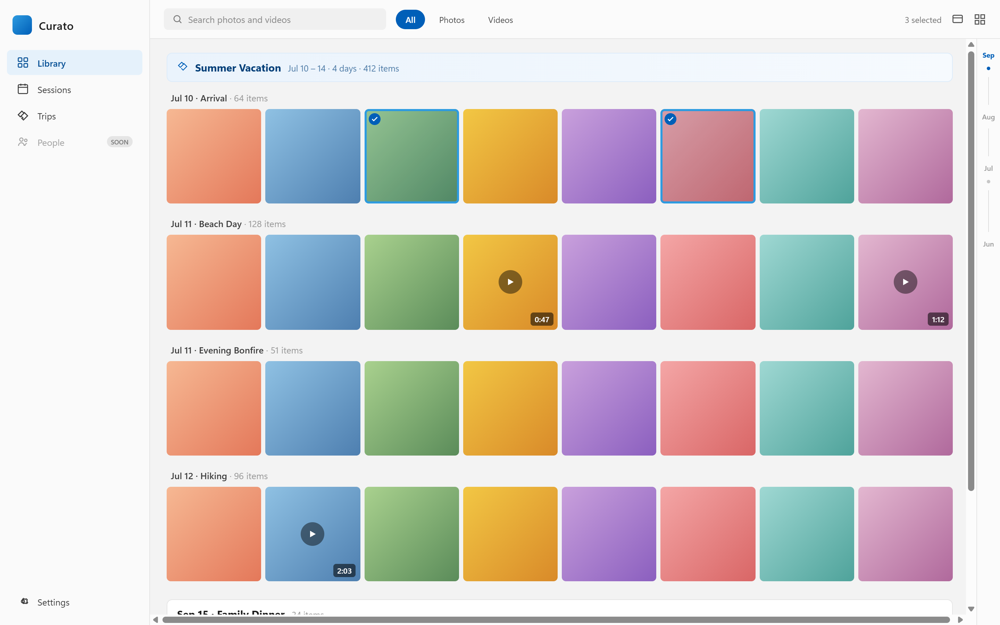
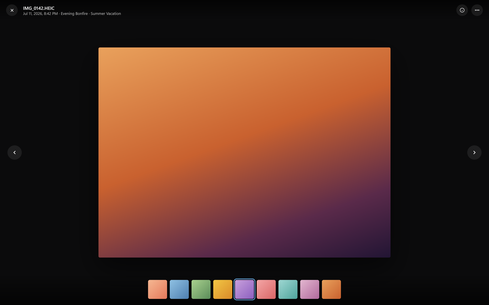
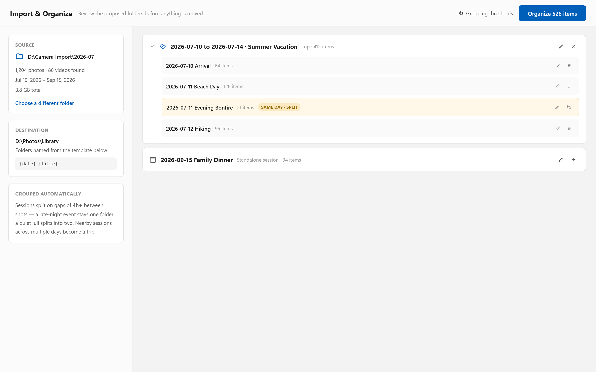

# Curato — UI Design

Companion to [`PLAN.md`](../PLAN.md). Three first-pass mockups in modern Fluent/WinUI 3
style (light theme shown; see the Dark theme note at the end). Live, editable versions
of these same three artboards are also on the
[Curato Mockups canvas](https://claude.ai/artifact/UnGy31BCv8D824y85ESCRU).

> **Note (post-pivot):** these mockups predate the move to a server + web UI
> architecture (`PLAN.md` §1) and show a native WinUI desktop shell. The *content* and
> flows below — the grid layout, the fullscreen viewer, the import/organize preview and
> its split/merge affordances — are still accurate; only the visual chrome (native
> Mica/acrylic window, WinUI nav rail) will differ once these are rebuilt as web
> mockups for `Curato.Web`.

## Main Gallery Grid

The primary, Picasa-like browsing screen.

- Left nav rail: **Library** (all media), **Events**, **Trips**, **People** (grayed
  out — phase 4), **Settings**.
- Top bar: search box, All/Photos/Videos filter chips, selection count, view-mode
  toggles.
- Content is a virtualized thumbnail grid, grouped under sticky headers that mirror the
  grouping engine's output: a **Trip banner** ("Summer Vacation · Jul 10–14") spans its
  events, each with its own sub-header ("Jul 11 · Beach Day", and — the same-calendar-
  day split case — "Jul 11 · Evening Bonfire" right after it), plus standalone events
  ("Sep 15 · Family Dinner") outside any trip.
- Video thumbnails carry a play-icon overlay and a duration badge; selected items show
  an accent-colored ring and checkmark.
- Right-edge vertical **date scrubber** for fast-scrolling a large library by month.

## Fullscreen Viewer

Lightbox view, opened from the grid. Deliberately near-black chrome in both light and
dark app themes — a light frame around a photo reads wrong.

- Thin top bar: filename, date/time, and the Event/Trip it belongs to; close (X) and
  info-toggle buttons.
- Large centered media area; left/right chevrons for prev/next navigation.
- Bottom filmstrip of nearby thumbnails, current item highlighted.
- Video state (same screen, mode-switched in the mockup): a scrubber, play/pause,
  elapsed/total time, volume, and fullscreen controls replace/augment the filmstrip area.

## Import & Organize Preview

The dry-run screen shown before any files move — nothing is copied/moved until
"Organize" is confirmed.

- Left column: source folder summary (item counts, date range, size), destination
  library path, the active folder-naming template (e.g. `{date} {title}`), and a plain-
  language explanation of the auto-grouping thresholds.
- Main area: the proposed folder tree — a **Trip** card ("2026-07-10 to 2026-07-14 ·
  Summer Vacation") containing its **Event** rows ("Arrival", "Beach Day", "Evening
  Bonfire" flagged *same day · split*, "Hiking"), plus a standalone event card outside
  any trip ("Family Dinner").
- **Manual override controls**, since auto-grouping is a proposal the user can always
  correct (see PLAN.md §3, Step 5):
  - **Rename** any event/trip title inline (pencil icon on every row).
  - **Split** an event into two at a chosen point in its filmstrip.
  - **Merge** two adjacent events into one (e.g. pull "Evening Bonfire" back into
    "Beach Day" if the auto-split guessed wrong).
  - **Group into a trip / ungroup**: select events and bundle them into a named trip
    range, or pull an event back out of one — this is how "Family Dinner" could later
    be added to a trip, or how a trip could be split apart.
- A settings-gear opens the grouping thresholds (event gap, trip gap, min trip span)
  from PLAN.md §3.
- Prominent accent "Organize N items" call-to-action, top right.

## Dark theme

All three screens are designed to re-theme rather than being redesigned per-theme (see
PLAN.md §7): WinUI 3's Mica/acrylic surfaces and built-in controls already adapt to the
OS theme, so light-mode mockups above are representative of the *layout*; only a
handful of custom colors (tile backgrounds, the accent, selection rings) need explicit
dark-theme values. A dark-theme pass of these same three artboards is a natural
follow-up once the layout direction here is confirmed.
